<div align="center">


<br>
<br>

<a href="https://www.espressif.com/en/products/socs/esp32-s3"></a>
<a href="https://lvgl.io"></a>
<a href="https://go.dev"></a>
<a href="https://vuejs.org"></a>
<a href="https://m3.material.io"></a>


<br>
<br>

<b>
<a href="#preview">Preview</a> ·
<a href="#features">Features</a> ·
<a href="#install">Install</a> ·
<a href="#firmware">Firmware & board</a> ·
<a href="#stack">Stack</a> ·
<a href="#dev">Development</a>
</b>

</div>

<br>

> **Roundbar** is a do-it-yourself round touch controller in the spirit of the Flexbar: a
> **Guition JC3636W518C** (ESP32-S3, 1.8" 360×360 round IPS touchscreen) on a USB cable. Its pages
> **change on their own with the app you're using**: shortcuts, now playing, system gauges, dials, timer,
> volume mixer and many more, in **Material 3 Expressive**. It works on Linux (GNOME, KDE Plasma, Hyprland,
> sway and other Wayland desktops, X11) and Windows. The board shows up as a **USB keyboard and mouse**, so
> shortcuts work even without the PC app, and **your setup lives on the board**: plug it into another PC and
> it brings everything along. Everything is set up in a **web configurator** with a live round preview.

<br>

<a name="preview"></a>


<table>
<tr>
<th width="25%">Now playing</th>
<th width="25%">Shortcuts</th>
<th width="25%">Browser</th>
<th width="25%">Code editor</th>
</tr>
<tr>
<td>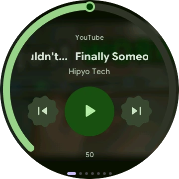</td>
<td>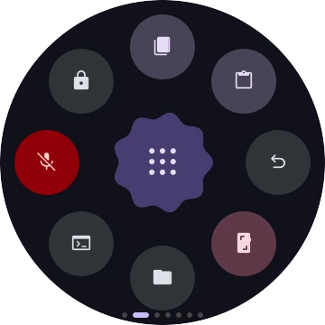</td>
<td>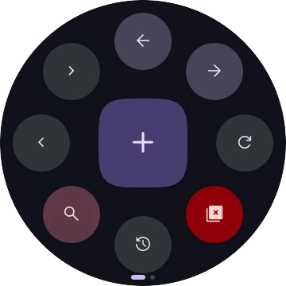</td>
<td>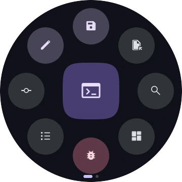</td>
</tr>
<tr>
<th>Voice chat</th>
<th>System</th>
<th>Clock and weather</th>
<th>Timer</th>
</tr>
<tr>
<td>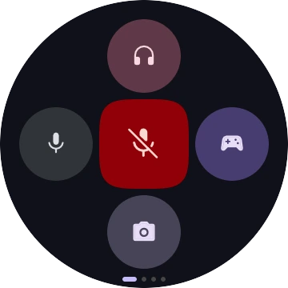</td>
<td>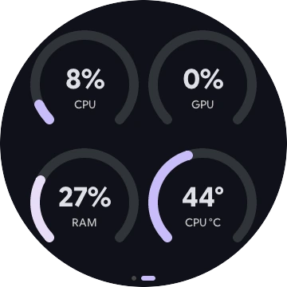</td>
<td>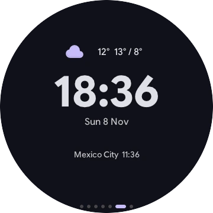</td>
<td>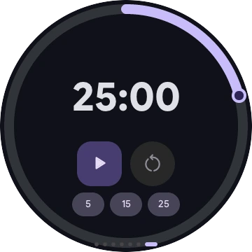</td>
</tr>
<tr>
<th>Mixer</th>
<th>Windows</th>
<th>Volume dial</th>
<th></th>
</tr>
<tr>
<td>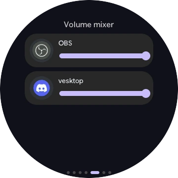</td>
<td>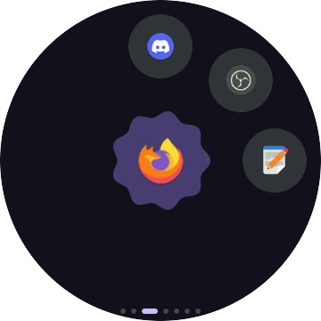</td>
<td>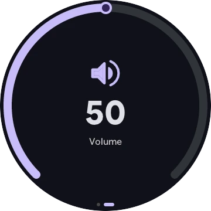</td>
<td></td>
</tr>
</table>

<div align="center">
<sub>Screenshots taken on the real board with <code>roundbar screenshot out.png</code></sub>
</div>

<br>

<table>
<tr>
<th>Profiles, dark theme</th>
<th>Profiles, light theme</th>
</tr>
<tr>
<td>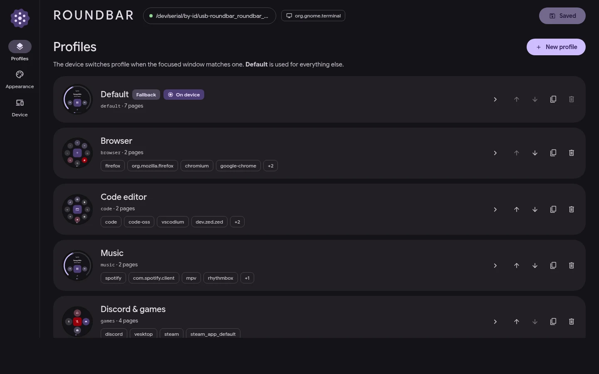</td>
<td>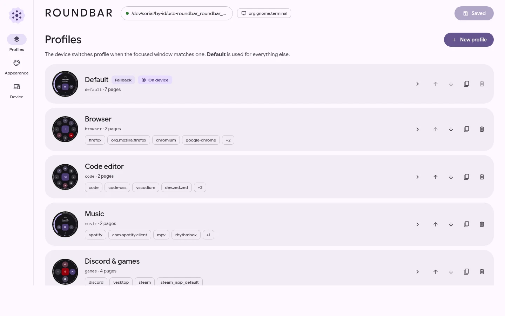</td>
</tr>
<tr>
<th>Page editor with the live round preview</th>
<th>The same editor, light theme</th>
</tr>
<tr>
<td>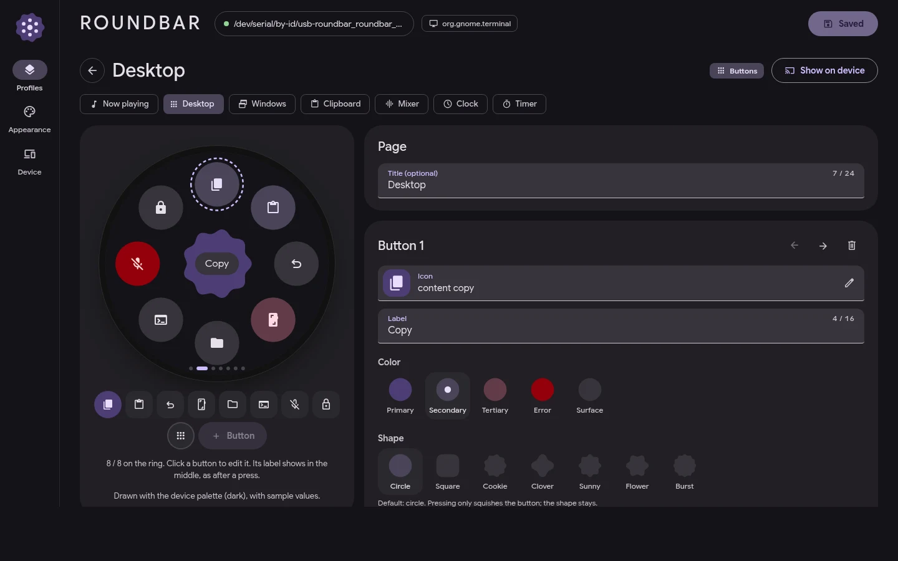</td>
<td>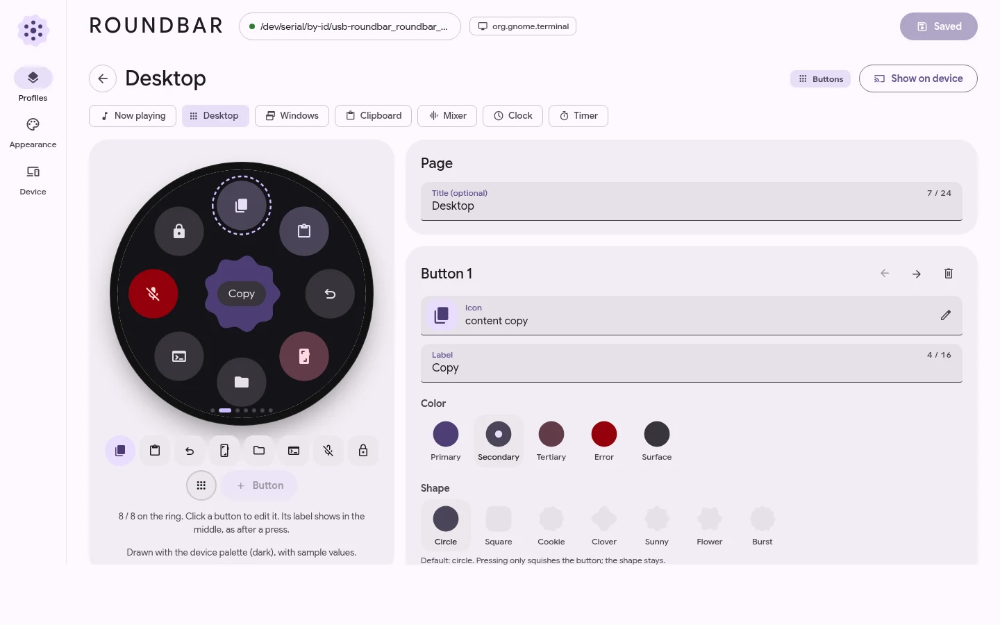</td>
</tr>
<tr>
<th>Appearance: Material You base color</th>
<th>Appearance, light theme</th>
</tr>
<tr>
<td>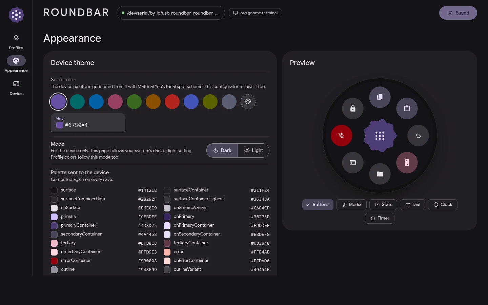</td>
<td>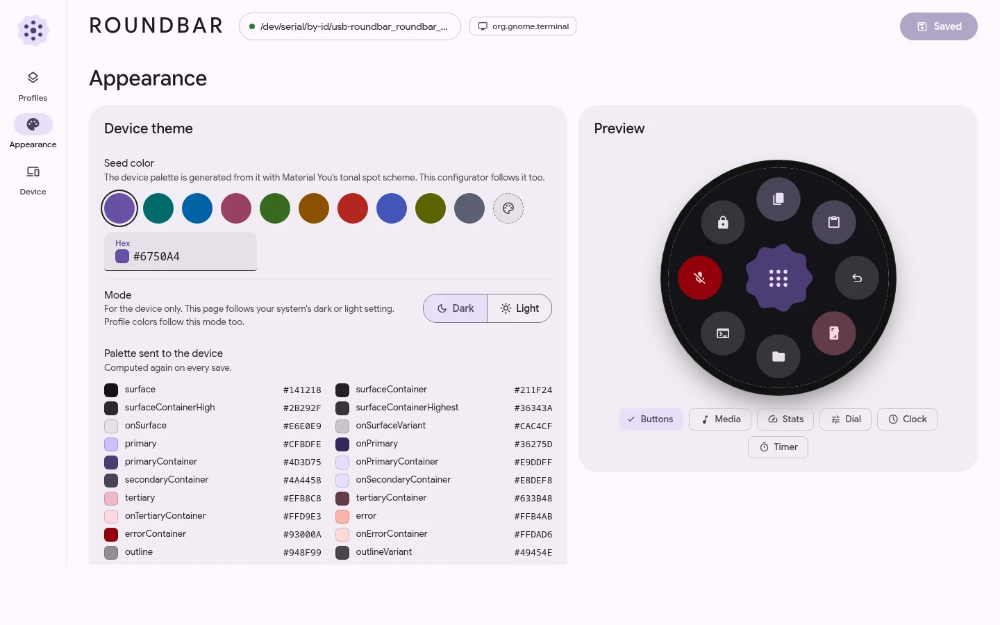</td>
</tr>
<tr>
<th>Device: status, screen, firmware updates</th>
<th>Device, light theme</th>
</tr>
<tr>
<td>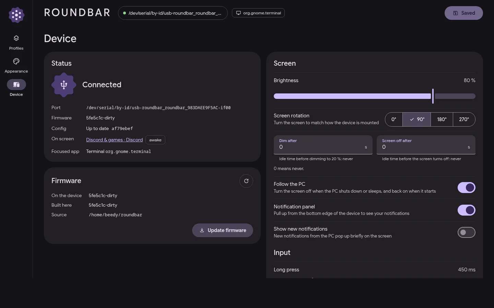</td>
<td>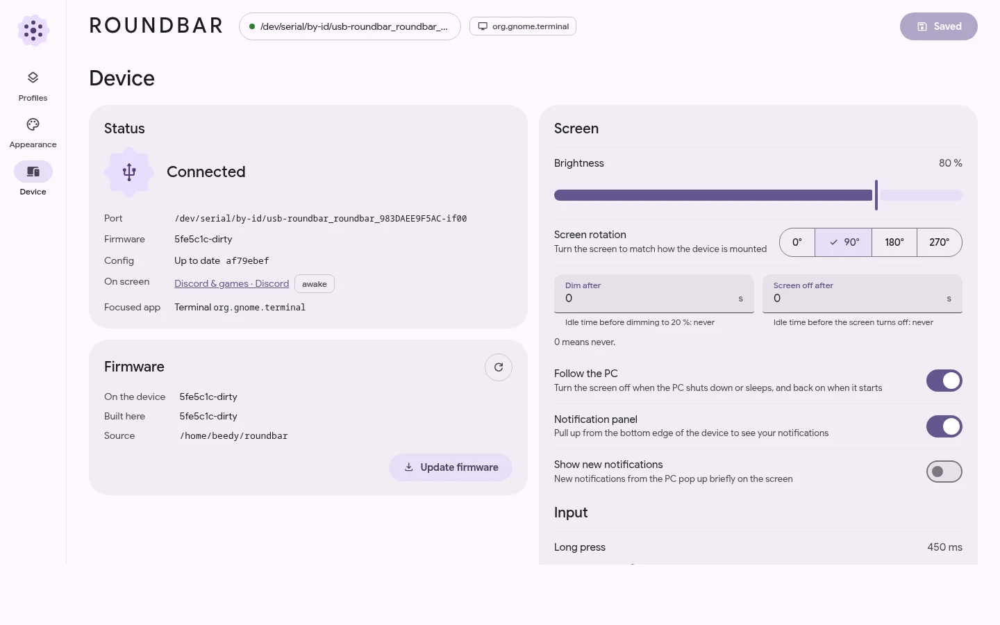</td>
</tr>
</table>

<br>

<a name="features"></a>


<table>
<tr>
<td width="33%" valign="top">

### Per-app profiles
Every app gets its **profile** and pages, with **wildcards** (`steam_app_*` for every Steam game). The board
switches **as soon as the focus changes** and remembers the **last page** of each profile. Auto-switching can be
paused from quick settings. Each profile can have **its own color**.

</td>
<td width="33%" valign="top">

### Shortcut pages
Up to **8 buttons on a ring** plus a center button, each with its **M3 Expressive** shape (circle, square,
cookie, clover, sunny, flower, burst) and an action on **tap** and **long press**: keys, text, media keys, go to
page, shell command, open an app or URL, mic mute, and **macros** with a recorder in the configurator.

</td>
<td width="33%" valign="top">

### Now playing
The active media player with title, artist, **blurred cover behind** and **colors taken from the cover**.
Previous, play and next in the middle, **volume on the edge arc**.

</td>
</tr>
<tr>
<td valign="top">

### System and dials
**CPU, GPU, VRAM, RAM and temperature** gauges (AMD, NVIDIA and Intel), sampled only while a stats page is on
screen. **Volume**, **mic**, **brightness** or **custom** dials, turned by sliding along the edge.

</td>
<td valign="top">

### Clock, timer, mixer
Analog or digital clock with the **weather** (Open-Meteo) and up to **3 world clocks**. A **timer** set on the
ring, with a **Pomodoro** mode. Per-app **volume mixer**, **window switcher** and **clipboard history**
(password-manager copies are skipped).

</td>
<td valign="top">

### Games and streaming
**Game**: the Steam game you're playing with its blurred art, session time, and buttons for the Steam overlay,
a screenshot and closing the game (asks first). **MangoHud**: FPS, average and 1% low, frame-time graph, CPU and
GPU on the edge arcs. **OBS**: record button with its timer, LIVE label and your scenes on a ring.
**Discord**: your voice channel live (who's in, who's talking, who's muted), with mute, deafen and leave.

</td>
</tr>
<tr>
<td valign="top">

### More pages
**Images**: a photo slideshow or an animated GIF. **Touchpad**: the board becomes a USB mouse (tap and long press
to click, drag and drop, scroll ring).

</td>
<td valign="top">

### Gestures and panels
Pull down for **quick settings**: page shortcuts, **screen off** (double tap to wake) and pausing auto-switching.
Pull up for your **notifications**. Pages **wrap around**, and a **double tap on the edge** changes page, opens
quick settings or turns the screen off, your choice.

</td>
<td valign="top">

### Follows the PC
The screen turns off when the PC shuts down or sleeps and back on when it returns. **Screen rotation**,
**Japanese, Chinese and Korean** text and **color emoji**. The board types with **your PC's keyboard layout**,
detected automatically: US, US international, UK, French, Belgian, German, Swiss, Spanish, Italian and Nordic.

</td>
</tr>
<tr>
<td valign="top">

### Your setup travels with it
The board keeps your setup. Plug it into a new PC and that PC takes it from the board; edit it anywhere and it
follows. Shortcuts work even on a PC without the app.

</td>
<td valign="top">

### Light and self-contained
The PC app reacts to events instead of polling: **~0% CPU and ~15 MB RAM** when idle. Integrations (OBS,
Discord, MangoHud) only connect while their page is on screen.

</td>
<td valign="top">

### The configurator
A live round preview drawn **like the board**, a **Material You** base color, copy and paste pages between
profiles, **undo / redo**, a **backup** zip you restore in one click, ready-made **presets**, **firmware updates**
in one click and a **setup wizard** the first time.

</td>
</tr>
</table>

<br>

<a name="install"></a>


No developer tools needed. The **[step-by-step guide](docs/guide.md)** walks through every step and has a
troubleshooting section.

**1. You need** a Guition **JC3636W518C** (ESP32-S3, 1.8" round screen, the version **with touch**) and a USB-C
cable that carries data.

**2. Put Roundbar on the board.** Open the **[web installer](https://beedywool-vibecoded.github.io/roundbar/)** in
Chrome or Edge, plug in the board and click *Install Roundbar*. If the board doesn't show up, hold its **BOOT**
button while plugging it in. Later updates happen from the app, in one click.

**3. Install the PC app.**

<table>
<tr>
<th width="50%" align="left">Linux</th>
<th width="50%" align="left">Windows 10 / 11</th>
</tr>
<tr>
<td valign="top">

```sh
curl -fsSL https://raw.githubusercontent.com/beedywool-vibecoded/roundbar/master/install.sh | sh
```

It installs the app in `~/.local/bin`, checks its checksum, asks once for your password to let you use the
board's USB port, and starts the background service. Arch: AUR package `roundbar-bin`. Every release also has
`.deb` and `.rpm` packages.

</td>
<td valign="top">

Download **`roundbar-setup-windows-amd64.exe`** from the
[latest release](https://github.com/beedywool-vibecoded/roundbar/releases/latest) and run it. No admin rights
needed. Roundbar starts with Windows and sits in the tray: click it to open the configurator.

</td>
</tr>
</table>

**4. Follow the setup wizard.** The configurator opens with a short wizard: it finds the board, updates its
firmware if needed, checks your keyboard layout, offers ready-made profiles for the apps you have installed and
sets up Steam, OBS, Discord and MangoHud if it finds them. Open it again any time with `roundbar config` or from
your app menu.

**Desktops.** Roundbar picks how to follow your desktop by itself (`roundbar status` shows which):

| Desktop | Active app | Windows | Notifications | Clipboard |
| --- | --- | --- | --- | --- |
| GNOME (Wayland or X11) | built-in extension (log out and back in once) | yes | yes | yes |
| KDE Plasma 6 (and 5) | KWin script loaded by Roundbar | yes | yes | Klipper |
| Hyprland, sway, river, niri, labwc, Wayfire… | `wlr-foreign-toplevel` | yes | yes | `data-control` |
| Other Wayland compositors | – | list only, with `ext-foreign-toplevel-list` | yes | with `data-control` |
| XFCE, Cinnamon, MATE, i3… (X11) | EWMH | yes | yes | yes |
| Windows 10 / 11 | yes | yes | – (Windows doesn't allow it) | yes |

**Commands**

| Command | What it does |
| --- | --- |
| `roundbar config` | Opens the configurator in your browser (`--no-open` only prints the URL) |
| `roundbar status` | Daemon, board and desktop status |
| `roundbar firmware check` / `update` | Compares the board's firmware with the latest release / installs it |
| `roundbar screenshot out.png` | Saves what the board shows as a PNG |
| `roundbar install` / `uninstall` | Sets up or removes the service, launcher, desktop integration and USB permission |
| `roundbar udev` | Only adds the USB permission rule (Linux) |
| `roundbar bootloader` | Reboots the board into USB download mode, for flashing |
| `roundbar daemon` | The bridge between the board and the desktop (run by the service) |

<br>

<a name="firmware"></a>


You only need this to build the firmware yourself. It needs **ESP-IDF v6**:

```sh
. ~/esp/esp-idf-v6.0.3/export.sh
make flash
```

`make flash` (or `tools/flash.sh`) reboots the board **into download mode by itself**, without touching BOOT,
and only writes the 9 MB font pack **when it changed**. From a source checkout, the configurator's *Firmware* card
also offers *Build from source*. A release (tag `v*`) publishes the binaries, packages, Windows installer, every
firmware part, the merged `roundbar-full.bin`, the `firmware.json` manifest and `SHA256SUMS`, then updates the web
installer (details in `docs/spec.md` §6; GitHub Pages must use *GitHub Actions* as its source).

<table>
<tr>
<td width="50%" valign="top">

**Board**
- Guition **JC3636W518C**, ESP32-S3
- **1.8"** round IPS touchscreen, 360×360
- **16 MB** flash, **8 MB** PSRAM
- USB: HID keyboard and mouse plus a CDC serial link (JSON lines)

</td>
<td width="50%" valign="top">

**Pins**
- LCD QSPI: SCK **9**, D0–D3 **11–14**, CS **10**, RST **47**, backlight **15**
- Touch I²C (CST816): SDA **7**, SCL **8**, INT **41**, RST **40**

</td>
</tr>
</table>

<br>

<a name="stack"></a>


<table>
<tr>
<th align="left">Folder</th>
<th align="left">What's in it</th>
</tr>
<tr><td><code>docs/spec.md</code></td><td>The contract between all parts: config, serial protocol, daemon socket, configurator API, desktop backends, releases.</td></tr>
<tr><td><code>docs/guide.md</code></td><td>The step-by-step install guide and troubleshooting.</td></tr>
<tr><td><code>firmware/</code></td><td>ESP-IDF 6 + LVGL 9.3 in C: Material 3 Expressive pages on the round screen, USB keyboard and mouse, CDC serial link.</td></tr>
<tr><td><code>cmd/roundbar</code></td><td>Entry point: <code>daemon</code>, <code>config</code>, <code>status</code>, <code>firmware</code>, <code>screenshot</code>, <code>install</code>…</td></tr>
<tr><td><code>internal/config</code></td><td>Reads, validates and watches <code>config.json</code>.</td></tr>
<tr><td><code>internal/daemon</code></td><td>The event-driven bridge between the board and the desktop, including the config sync with the board.</td></tr>
<tr><td><code>internal/device</code></td><td>USB CDC connection and JSON messages with the board.</td></tr>
<tr><td><code>internal/desktop</code></td><td>Focus, windows, notifications and clipboard per desktop (GNOME extension, KWin script, Wayland protocols, X11, Windows), MPRIS.</td></tr>
<tr><td><code>internal/audio</code></td><td>Volume, mic and per-app mixer.</td></tr>
<tr><td><code>internal/stats</code></td><td>CPU, RAM, GPU and temperatures (amdgpu, Intel fdinfo, <code>nvidia-smi</code> only while a GPU gauge is shown).</td></tr>
<tr><td><code>internal/espflash</code>, <code>internal/fwupdate</code></td><td>The built-in ESP32-S3 flasher and firmware updates from GitHub releases.</td></tr>
<tr><td><code>internal/keymap</code></td><td>Keyboard layouts: character → HID keys (dead keys, AltGr), detection of the PC's active layout.</td></tr>
<tr><td><code>internal/cover</code>, <code>internal/assets</code>, <code>internal/icons</code></td><td>Cover art, image pages and app icons, rendered for the board.</td></tr>
<tr><td><code>internal/discord</code>, <code>internal/obs</code>, <code>internal/steam</code>, <code>internal/mangohud</code></td><td>Integrations, each connected only while its page is shown.</td></tr>
<tr><td><code>internal/configui</code></td><td>The configurator's HTTP server on 127.0.0.1.</td></tr>
<tr><td><code>web/</code></td><td>The Vue 3 configurator, Material 3 Expressive, embedded in the binary.</td></tr>
<tr><td><code>gnome-extension/</code></td><td><code>roundbar@beedy</code>: publishes focus, windows, notifications and clipboard on D-Bus, signals only. On GNOME Wayland it's the only way to know the active window.</td></tr>
<tr><td><code>shared/</code></td><td><code>icons.json</code> (the Material Symbols subset in the firmware) and <code>keymaps.json</code> (keyboard layouts; add one with <code>tools/keymap-from-xkb.py</code>, then <code>go run ./tools/gen-keymaps</code>).</td></tr>
<tr><td><code>site/</code></td><td>The web installer page (ESP Web Tools), deployed to GitHub Pages.</td></tr>
<tr><td><code>packaging/</code>, <code>install.sh</code></td><td>AUR, <code>.deb</code>/<code>.rpm</code> (nfpm), the Windows installer and the Linux install script.</td></tr>
<tr><td><code>tools/</code></td><td><code>flash.sh</code>, <code>fontpack</code> (CJK and emoji glyph pack), <code>fwrelease</code>, <code>gen-icons.py</code>, <code>gen-keymaps</code>, <code>readme-assets.py</code>.</td></tr>
</table>

<br>

<a name="dev"></a>


Needs Go, Node and npm (and ESP-IDF v6 for the firmware):

```sh
make                                              # configurator + Go binary in bin/roundbar
make install                                      # installs it for your user
make test                                         # go test ./...
make firmware                                     # idf.py build, with ESP-IDF loaded
make flash                                        # builds and flashes the board
go run ./tools/fontpack -out firmware/build/fonts.bin   # rebuilds the glyph pack
```

<details>
<summary><b>Notes</b></summary>

<br>

- Change `docs/spec.md` **first**, then the code of each part.
- The config lives in `~/.config/roundbar/config.json` (`%APPDATA%\roundbar` on Windows). The configurator writes
  it, the daemon watches it and syncs it with the board, which keeps a copy in flash.
- The glyph pack is built from the system's Noto Sans CJK and Noto Color Emoji. `FORCE_FONTS=1 make flash`
  rewrites it even when unchanged.
- The README visuals are regenerated with `python3 tools/readme-assets.py`.
- CI checks Go (`gofmt`, `vet`, tests with `-race`), the configurator and the firmware (in the
  `espressif/idf:v6.0.3` container).

</details>

<br>

**License.** Code under the [MIT license](LICENSE). Bundled fonts: Google Sans Flex (SIL OFL 1.1) and Material
Symbols (Apache 2.0). The ST77916 screen init sequence comes from the community ESPHome config
[clowrey/esphome-guition-360x360-jc3636w518](https://github.com/clowrey/esphome-guition-360x360-jc3636w518).

<br>


